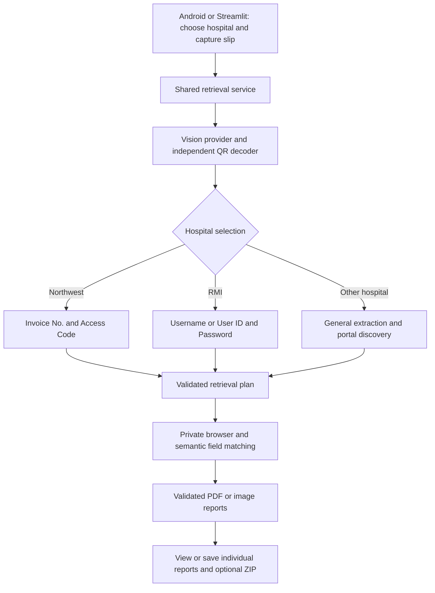

# Architecture

## Shared flow

## Responsibilities

| Component | Owns |
|---|---|
| `ui/` and `mobile/lib/screens/` | Hospital choice, image selection, progress, report controls |
| `backend/routes/` | Multipart inputs and safe public job/result responses |
| `services/report_retrieval.py` | The UI-independent pipeline used by both clients |
| `document_understanding/` | Provider abstraction, structured results, normalization, QR decoding |
| `document_understanding/hospitals.py` | Profiles, focused prompts, requirements, mismatch checks |
| `workflow/` | Portal candidates, safe search, deterministic plans, state |
| `browser_agent/` | Browser lifecycle, destination checks, form matching, bounded actions, downloads |
| `services/files.py` and `utils/` | File validation, generated names, cleanup, logging |
| `config/settings.py` | Environment configuration |

The API and Streamlit adapt the same engine. Hospital profiles supply context
and requirements without duplicating provider or browser implementations.

## Hospital profiles

The selected hospital guides the vision prompt. The server then filters fields
to one unambiguous value per required role. Northwest does not substitute an MR
number for an invoice number; RMI does not use unrelated patient IDs as usernames.
A confidently identified different organization or missing/conflicting access
fields stops the focused path before browser execution.

Other hospital retains the general engine. Existing administrator-managed portal
overrides take precedence over a profile's published URL. All destinations still
pass normal browser validation.

## Execution and storage

- **Background:** `POST /api/v1/jobs` creates a process-local job. Clients poll
  its opaque ID and download files using job-owned opaque file IDs.
- **Synchronous:** `POST /api/v1/retrieve` keeps retrieval inside the request.
  Clients download result files immediately, then delete the temporary result.
- **Streamlit:** the session stores workflow state and invokes the same service
  in stages, including explicit user-input recovery where supported.

State and files are temporary and limited to one instance/worker. A shared queue,
database, and object storage are required for durable scaling.

## Boundaries

Credentials and patient identifiers are excluded from progress responses and
normal logs. Chromium uses a temporary private context and bounded actions.
Authentication is submitted at most once; CAPTCHA, OTP, unsafe destinations,
and ambiguous report choices stop automation. Files pass signature, size, type,
and owned-path validation before delivery.

Gemini/OpenAI modes send the image to the configured provider. Ollama inference
stays local. Production disables debug mode and rejects the broad HTTP override;
administrator-managed exact-host HTTP exceptions remain permitted.

The independent-phone pilot uses Firebase Email/Password sign-in. Every API call
verifies its ID token (including revocation) and checks an explicit tester UID
allowlist. Job/result/file routes also check the authenticated owner. See the
[pilot deployment guide](CLOUD_RUN_PILOT.md). Local or IAM-private deployments
can retain `API_AUTH_MODE=none`; do not use that mode with public ingress.
